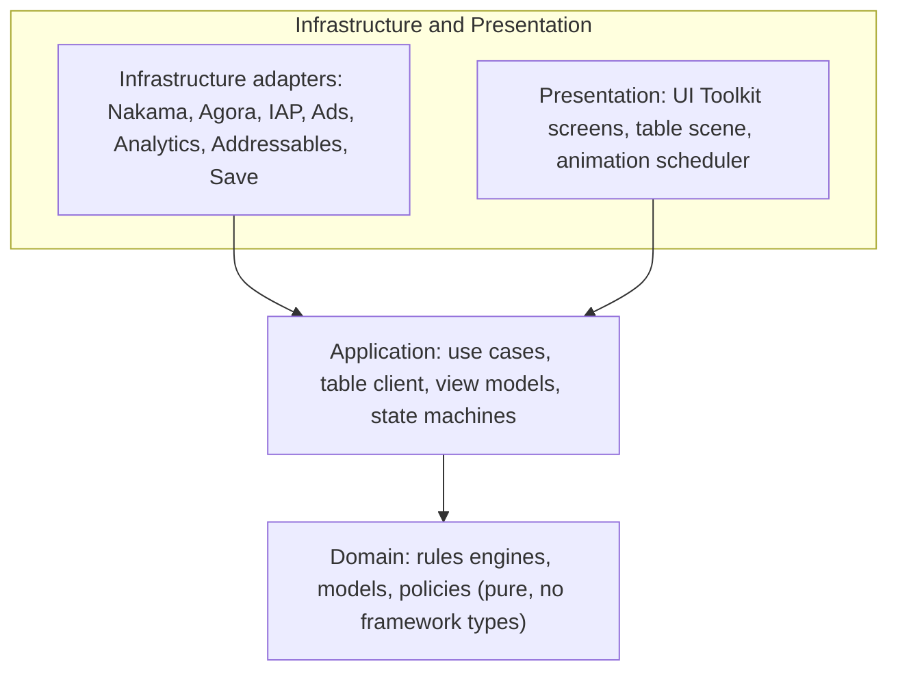
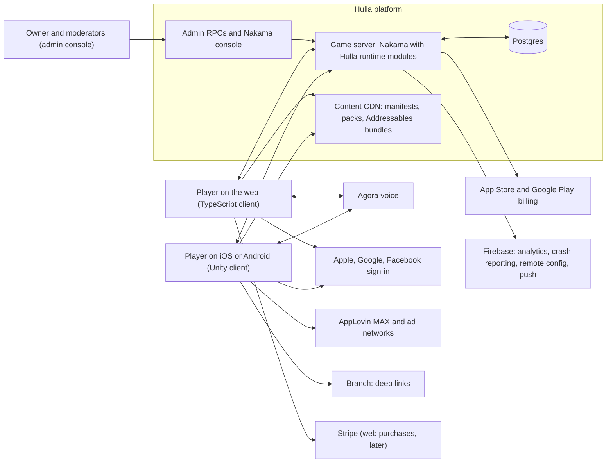
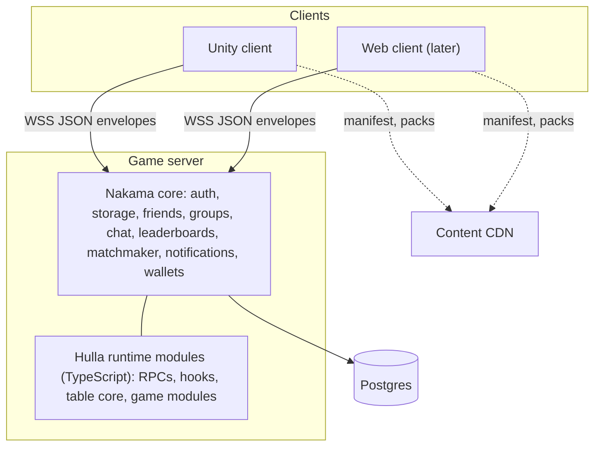
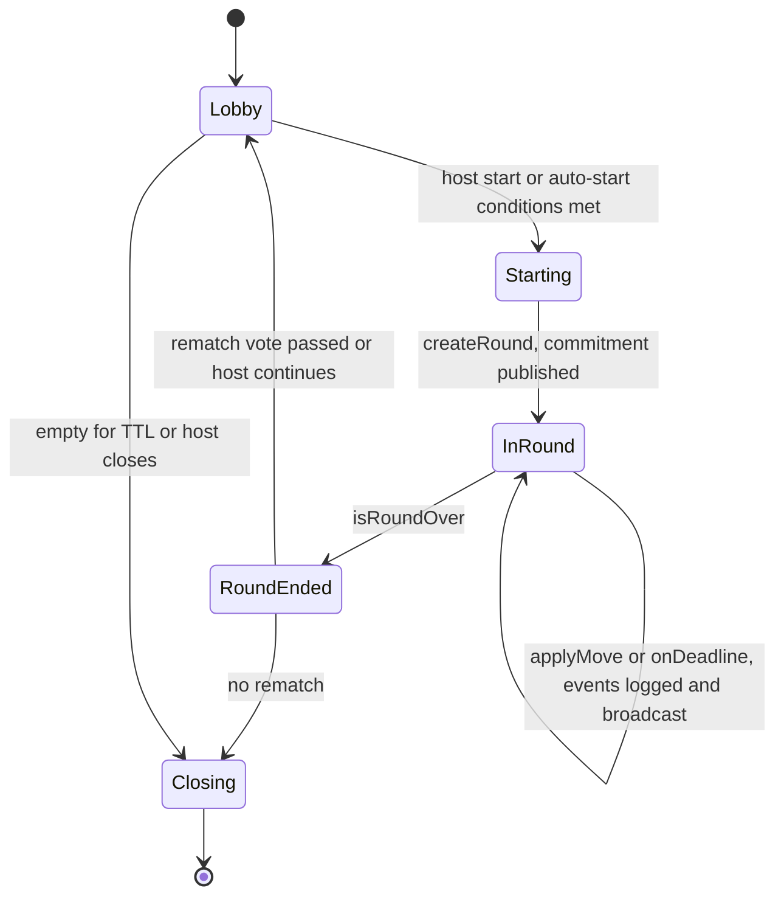
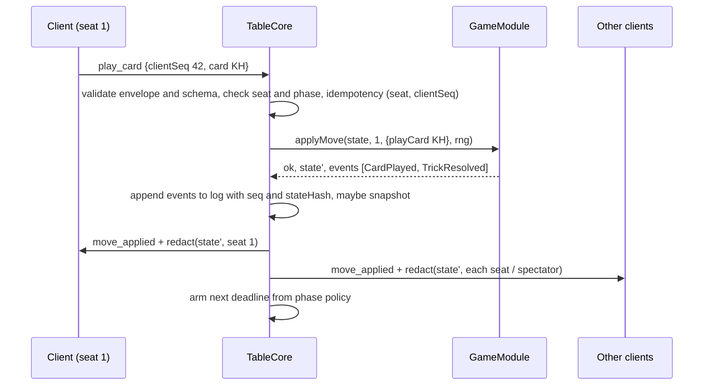
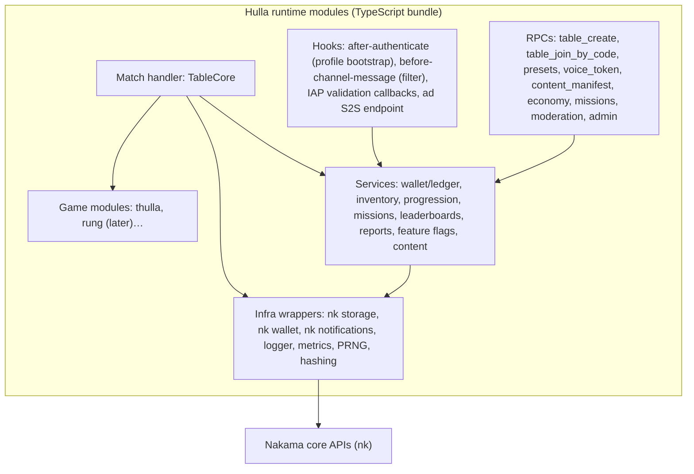
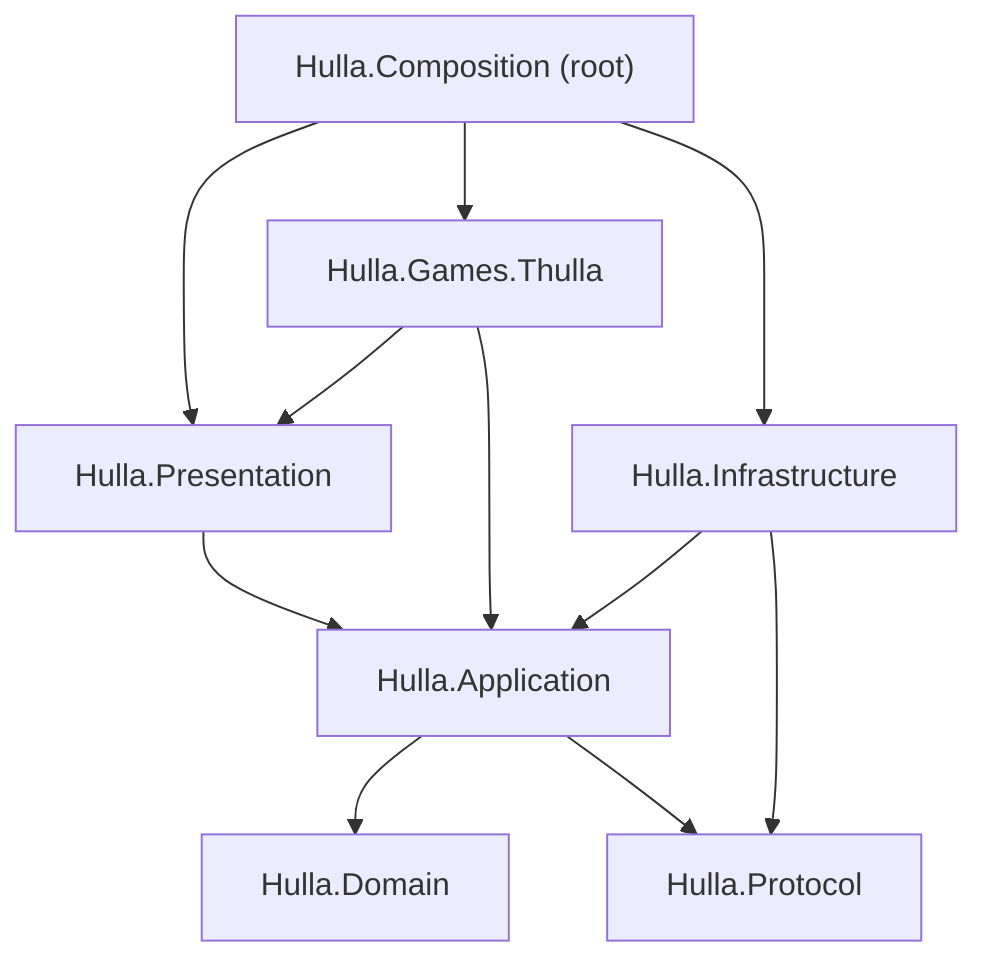
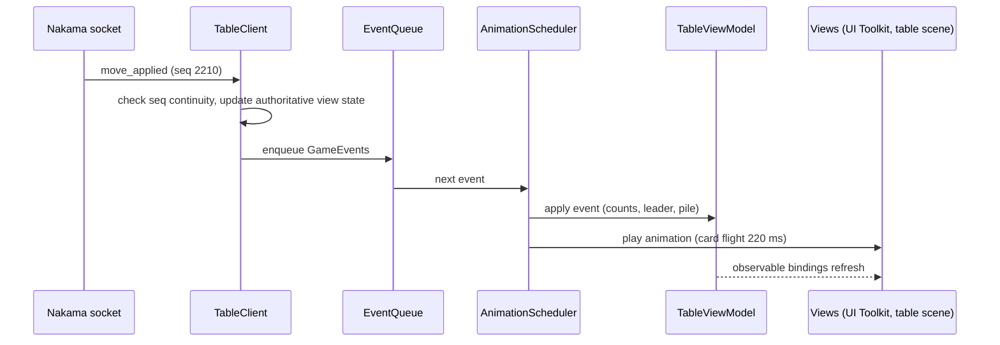

# Hulla Platform Architecture

> **Version:** 1.0 · **Date:** 11 October 2026 · **Status:** Draft for review · **Owner:** Khizer Khalid
> Companion to the GDD (a private document, not in this repository; especially §6, §18–21, §28–29) and to the decision records in `docs/adr/`. Conventions are in `CODING_RULES.md`; new contributors start at `docs/CONTEXT.md` and `CONTRIBUTING.md`.

## 0. How to read this document
- **[MUST]** marks a constraint that code and reviews enforce. **[SHOULD]** marks a strong default that needs a written reason to break. **[LATER]** marks a design that is reserved, not built.
- Every section names the GDD sections it implements so the two documents can be reconciled. When they disagree, the GDD decides product behaviour and this document decides structure; raise the conflict in `docs/OPEN_QUESTIONS.md`.
- Diagrams use C4 vocabulary loosely: context (who talks to the system), containers (deployable units), components (inside a container).

## 1. Architectural drivers
| Driver (from the GDD) | Architectural implication |
|---|---|
| Hidden-information multiplayer with real stakes of pride (§6, §24) | The server is the only authority. Hands and private draws live only on the server: in match memory during the round, then in the round log and snapshots (§8.8); they never reach a client. Every view is redacted per recipient and redaction is tested. Clients predict only cosmetic card motion. |
| Many games, one shell (§1.7, §18) | A game is a module behind one contract on the server and one on each client. The table core (seats, timers, log, snapshots, rematch, series) is generic and never knows a card from a dice. New games add code only in their module and content folders. |
| Unity first, web second, same server (§19–21) | The protocol is client-agnostic and schema-first. The TypeScript rules engine is authoritative and reused by the web client; the C# mirror is deferred past v1.0 (ADR-0019) and clients take legality from the server's mask. |
| Low-end Android, 3G, late-night drops (§4.2, §9.8, §19.5) | Small JSON payloads, sequence numbers, snapshots on gaps, 30-second reconnection with auto-play cover, 60 fps budgets, zero-allocation table loop. |
| One developer, fast iteration (§29) | Boring, well-documented technology; strong conventions enforced by tooling rather than memory; tests are the specification; small modules with narrow interfaces. |
| No wagering, moderation, privacy (§13, §24, §25) | Economy code has no path from money to coins to outcome. Chat and voice have mute, report, filter and strike hooks. PII is minimal, deletable and never logged. |
| Lean cost (§20.14) | Self-hosted Nakama, one region first, managed Postgres, content on a CDN. |

**Quality attribute targets** (full list in GDD §4.2, §19.5, §20.13): 60 fps at the table on a 2 GB Android device; cold start under 3 s; p95 move round-trip under 250 ms in region; 99.5% monthly availability; crash-free sessions above 99.6%; under 50 KB per minute of game traffic excluding voice.

## 2. Principles and how they are enforced

### 2.1 Clean architecture
Dependencies point inward. The **Domain** (rules engines, models, pure logic) depends on nothing. **Application** (use cases, table client, view models, orchestration) depends on Domain. **Infrastructure** (Nakama, Agora, IAP, ads, analytics, storage) and **Presentation** (UI Toolkit, table scene) depend on Application and Domain, never on each other. The composition root is the only place that knows every concrete type.



### 2.2 SOLID, mapped to this codebase
| Principle | What it means here | Where it shows |
|---|---|---|
| **Single responsibility** | One reason to change per unit. Table mechanics, game rules, redaction, persistence, rendering and animation timing are separate units. | `TableCore` (seats, timers, log) never contains card logic; `Redactor` is its own function; `AnimationScheduler` is separate from `TableClient`. |
| **Open for extension, closed for modification** | Adding a game, a voice provider, a cosmetic pack or a rule variant must not edit the shell. | New `GameModule` + content folder; `IVoiceService` adapters; rule toggles interpreted inside the engine through small strategy functions, never as `if (game === "rung")` in the shell. |
| **Liskov substitution** | Any module works with any table core; any transport works with any table client. | Contract tests run every module through the same table-core test suite; `LocalMatchHost` [LATER] and `NetworkMatchHost` both satisfy `ITableSession`. |
| **Interface segregation** | Consumers see only what they need. | The Unity module contract is six small interfaces, not one god interface; services are narrow (`IVoiceService` is not `IChatService`). |
| **Dependency inversion** | High-level policy owns the interfaces; adapters implement them; the composition root wires them. | Application defines `IVoiceService`, `IWalletGateway`, `ITableSession`; Infrastructure implements; a hand-written composition root (client) and a factory (server) compose (ADR-0008). |

### 2.3 Further principles
- **Determinism [MUST].** Engines receive the random generator as their only input beyond state and move; there is no clock (ADR-0020). Same state, same inputs, same output, forever (ADR-0009).
- **Immutability in the domain [MUST].** Engine state is treated as immutable; `applyMove` returns a new state plus events. This makes snapshots, hashes, replays and tests trivial.
- **Explicit errors [MUST].** Domain and application code return `Result` values with error codes from the catalogue (§12.5). Exceptions are for programmer errors and boundary failures only.
- **Data over code [SHOULD].** Presets, quick-chat packs, catalog, missions, strings and bot rosters are validated JSON delivered through a manifest (ADR-0011).
- **Observability by design [SHOULD].** Every state transition emits a structured event with ids that join across client, server and analytics.
- **Boring technology [SHOULD].** Prefer the well-trodden path (Nakama, Postgres, UI Toolkit, JSON) over novelty; novelty needs an ADR.

### 2.4 Enforcement
| Rule | Mechanism |
|---|---|
| Unity layer boundaries | Assembly definitions with explicit references; `Hulla.Domain` has `noEngineReferences: true`; a NetArchTest suite asserts forbidden references |
| TypeScript boundaries | `dependency-cruiser` rules: `rules-engine` imports nothing from `server`, `protocol` or Node; `server` never imports from `apps/web` |
| Purity of engines | ESLint `no-restricted-globals` (Date, Math.random, setTimeout) and `no-restricted-imports` (node:*) in engine packages; C# analyzers ban `UnityEngine`, `System.Random`, `DateTime.Now` in `Hulla.Domain` |
| Protocol drift | Generated code committed; CI regenerates and fails on diff |
| Redaction | A test asserts that no hidden field appears in any non-owner view for every event in the vector suite |
| Spec traceability | Test names carry rule IDs (`R21_thulla_picker_is_highest_of_led_suit`); CI fails if any R-id or E-id from the GDD has no test |

## 3. System context

Implements GDD §18.2, §20.3.

## 4. Containers
| Container | Technology | Responsibility | Scales by |
|---|---|---|---|
| **Unity client** | Unity 6 (6000.4.9f1, ADR-0016), C#, UI Toolkit, 2D URP | Shell UI, table rendering, local prediction, offline [LATER], SDK adapters | App store distribution |
| **Web client** [LATER] | TypeScript, React, PixiJS, Vite | Same shell and modules for browsers, link-join without install | CDN |
| **Game server** | Nakama (Go binary) running Hulla TypeScript runtime modules | Auth, social, tables, matchmaking, authoritative matches, economy, moderation, notifications | Vertical first, then regional clusters (ADR-0002) |
| **Database** | Managed Postgres | Nakama storage, wallets, leaderboards, round results, reports | Managed vertical scaling and replicas |
| **Content CDN** | Object storage plus CDN | Signed manifests, JSON packs, Addressables bundles | CDN |
| **Admin** | Nakama console plus custom RPCs | Moderation actions, table inspection, replay, feature flags | n/a |
| **Observability** | Prometheus, Grafana, structured logs | Metrics, dashboards, alerts | n/a |
| **CI** | GitHub Actions | Tests, codegen drift, content validation, builds, store upload | n/a |



## 5. Repository layout and package boundaries
```
hulla/
├─ apps/
│  ├─ unity/Hulla/                 Unity 6 project (asmdef per layer, see §9.1)
│  └─ web/                         TypeScript web client [LATER]
├─ server/nakama/                  Runtime modules (TypeScript → one bundle), config, Dockerfile, local compose
├─ packages/
│  ├─ protocol/                    JSON Schemas (source of truth) + generated TS and C# (committed)
│  ├─ rules-engine/                Pure TS engines: thulla/, rung/… plus shared card kit
│  ├─ rules-engine-cs/             Pure C# mirrors (netstandard2.1) + test project [LATER, ADR-0019]
│  ├─ shared-ts/                   Result type, ids, PRNG, hashing helpers shared by server and web
│  └─ test-vectors/                JSON vectors, traceability matrix, runners for both engines
├─ content/                        presets/ quick-chat/ catalog/ missions/ strings/ tokens/ bots/ (schemas in tools/)
├─ infra/                          compose for local, terraform or scripts for prod, dashboards, alerts
├─ tools/                          codegen, content validator and signer, strings and tokens export, vector generator, replay, equivalence harness
├─ docs/                           ARCHITECTURE.md, adr/, runbooks/, OPEN_QUESTIONS.md
└─ .github/workflows/              ci.yml, nightly.yml, release-android.yml, server-image.yml (web.yml later)
```

| Package | Language | May depend on | Must never depend on |
|---|---|---|---|
| `packages/rules-engine` | TS (no Node APIs) | `shared-ts` | `protocol`, `server`, any client, Node built-ins |
| `packages/rules-engine-cs` [LATER, ADR-0019] | C# netstandard2.1 | nothing | UnityEngine, System.Random, DateTime.Now |
| `packages/protocol` | JSON Schema; generated TS and C# | nothing | hand edits in generated folders |
| `packages/shared-ts` | TS | nothing | Node built-ins (so the web can use it) |
| `server/nakama` | TS (Nakama runtime) | `rules-engine`, `protocol`, `shared-ts` | `apps/*` |
| `apps/unity` | C# | `rules-engine-cs` (as a local UPM package), generated C# protocol | server code |
| `apps/web` | TS | `rules-engine`, `protocol`, `shared-ts` | `server` internals |
| `content/*` | JSON | schemas in `tools/content-schemas` | code |

Tooling: Node 26 (24 or later), pnpm 12 workspaces pinned through `packageManager`, TypeScript 5.9 strict (the 7.x native compiler is adopted once typescript-eslint can read it), Vitest, ESLint 10 flat config with `eslint-plugin-import-x` and Prettier, dependency-cruiser; .NET 10 SDK for the C# packages and their tests (LTS until November 2028; .NET 8 leaves support on 10 November 2026), Roslyn analyzers through `.editorconfig`; Unity 6000.4.9f1 pinned in `ProjectVersion.txt` (ADR-0016).

## 6. Domain model and ubiquitous language
| Term | Meaning | Owner |
|---|---|---|
| **Player** | An account with a profile, wallet, inventory and progress | Shell |
| **Table** | A room: settings, seats, spectators, chat, voice channel, scoreboard, series state. Hosts rounds. | Shell (`TableCore`) |
| **Seat** | A position at the table with `seatIndex`, `teamId`, occupant (player, empty, auto-play) | Shell |
| **Round** | One play of a game from deal to result; owns the event log and snapshots | Shell lifecycle, module content |
| **Phase** | A stage within a round with its own legal action kinds and deadline policy (Thulla: opening, play; Rung: deal5, call, deal8, play) | Module |
| **Move** | A player action the module validates and applies (play card, take hand, call trump, submit hidden, vote, text) | Module |
| **Event** | A fact emitted by applying a move (card played, thulla, pickup, escape, round ended), the only thing clients render | Module emits, shell logs |
| **Rules / Preset** | The toggle set for a round, validated against the module's schema | Module schema, shell storage |
| **Series** | Scoreboard across rounds (Bhabhi tally, Baithak points, courts) | Shell state, module update function |
| **Result** | Per-round outcome used for rewards, stats and ratings | Module produces, shell consumes |
| **Wallet / Ledger** | Coins and gems with an append-only history | Shell (Nakama wallet) |
| **Catalog / Inventory** | Purchasable and owned cosmetics, tagged by game | Shell, content |

Urdu and Hindi terms from the GDD map to code names: thulla → `Thulla` event, haath → `Lead`/`leaderSeat`, haath lena → `TakeHand` move, bhabhi → `loserSeat` with a display title, baithak → `Table` of kind `private`, adda → `Group`. Code uses the English identifiers; UI uses localised strings.

Aggregates and consistency: the **Table** is one aggregate owned by exactly one match handler instance, so all round state changes are serialised by construction. **Player** data (profile, wallet, inventory, progress) is per-user storage with optimistic concurrency. Cross-aggregate effects (rewards after a round) are written by the match handler at round end with idempotency keys so a retry never pays twice.

## 7. The game module system

### 7.1 Server contract
```ts
// packages/rules-engine/src/contract.ts — implemented by every game, consumed only by the table core
export interface GameModule<S, M, V, R extends RuleSet = RuleSet> {
  readonly id: GameId;                       // "thulla", "rung", "ludo"…
  readonly version: string;                  // rules version; rounds pin it
  readonly seats: SeatSpec;                  // { min, max, teams?: { count, size, arrangement } }
  readonly direction: "cw" | "ccw" | "configurable";
  readonly rulesSchema: JsonSchema;          // toggles, defaults per mode, presets
  readonly phases: readonly PhaseSpec[];     // ordered phases with allowed ActionKinds and deadline policy

  createRound(input: CreateRoundInput<R>, rng: Rng): Result<S, RuleError>;   // total: bad input is an error, not a throw
  currentPhase(state: S): PhaseId;
  legalMoves(state: S, seat: SeatIndex): readonly M[];
  applyMove(state: S, seat: SeatIndex, move: M, rng: Rng): ApplyResult<S>;
  onDeadline(state: S, seat: SeatIndex): M | null;  // deterministic auto-play (GDD R44); null when the seat cannot act
  redact(state: S, viewer: Viewer): V;       // hidden information never leaves here
  isRoundOver(state: S): boolean;
  results(state: S): RoundResult;
  seriesUpdate(series: SeriesState, result: RoundResult): SeriesState;

  botPolicy?(view: V, tier: BotTier, rng: Rng): M;              // optional, GDD D7
  quickChatContext?(events: readonly GameEvent[]): readonly QuickChatContext[];
}

export type ApplyResult<S> =
  | { ok: true; state: S; events: readonly GameEvent[] }
  | { ok: false; error: RuleError };        // code from the error catalogue, never a thrown exception
```
`rulesSchema` covers only the toggles that change legality or outcomes; table settings such as timers, the loser's title, card-count display and the memory assist are table-core configuration delivered through the same preset files. Rules of the contract [MUST]: pure functions; no IO; no clock at all (ADR-0020); no randomness except through the injected `Rng`; state is never mutated; `redact` is total (works for every state and viewer, including spectators); `onDeadline` returns a legal move for any seat that has one and null otherwise; `legalMoves` and `applyMove` agree (a move is legal if and only if `applyMove` returns `ok`); a replay needs only the seed and the move log.

### 7.2 Table core
`TableCore` is the generic host for any module. It owns seats and teams, presences and reconnection tokens, phase deadlines and the tick clock, the event log and snapshots, redaction dispatch, idempotency, the rematch loop and series state, and the bridge to shell services (rewards, stats, missions) at round end.



Sequence for a move (implements GDD §9.7, §20.5):


### 7.3 Actions and primitives for every game category
The shell understands a small set of **action kinds**; modules compose them. This is what lets Antakshari, Hand Cricket and Tambola share one table core with Thulla (GDD §18.12).

| Action kind | Semantics in the table core | Used by |
|---|---|---|
| `Move` | Ordinary validated move for the acting seat | All games |
| `HiddenCommit` / `HiddenReveal` | Commit a hash of a secret input in phase A, reveal in phase B; the core verifies the hash and rejects mismatches; late reveals default per module policy | Hand Cricket, Raja Mantri's guess, Stone Paper Scissors |
| `Vote` | One ballot per seat per voting phase; the core tallies and hands the result to the module | Antakshari judging, Mafia lynch votes |
| `Judge` | A single designated seat (host or rotating judge) decides; the core enforces who may judge | Dumb Charades voice variant, dispute resolution |
| `Text` | Free text with length, rate and filter checks performed by the core before the module sees it | Name Place Animal Thing, Antakshari song titles |
| `PhaseAdvance` | Module-driven phase transition with a new deadline policy | Rung (deal → call → play), party games |

Phase deadline policies: `perSeatTimer(seconds)`, `simultaneousWindow(seconds)`, `none`. Thulla uses `simultaneousWindow(10)` for the opening trick and `perSeatTimer(15)` afterwards (GDD R43).

### 7.4 Client contract (Unity)
```csharp
// apps/unity/Hulla/Assets/_Project/Application/Games/IGameModule.cs
public interface IGameModule
{
    GameId Id { get; }
    ITableLayout Layout { get; }                 // seat arcs, direction, pile zones, team colouring
    IStateRenderer Renderer { get; }             // turns GameEvents into animations on the table
    IInputController Input { get; }              // legal-move highlighting, selection, phase inputs
    IRulebook Rulebook { get; }                  // preset sentences, glossary, auto-play policy text
    IQuickChatContextProvider QuickChat { get; } // contextual phrase suggestions
    ITutorial Tutorial { get; }                  // scripted deals and coach steps
    IResultsAdapter Results { get; }             // RoundResult → shared results screen model
    IOfflineEngine? OfflineEngine { get; }       // C# mirror; null until the offline milestone (ADR-0010)
}
```
Each sub-interface is small so a module can start with a default implementation from the shared **table kit** (card fan, pile zone, seat ring, timer ring, stamp effects) and override only what the game needs.

### 7.5 One engine at launch, a mirror reserved
The TypeScript engine is the only engine at launch. ADR-0003 reserves a C# mirror for offline play and ADR-0019 defers it past v1.0: the server sends each seat its legal mask in `turn_start` before the seat can act, so highlighting needs no local engine, and offline play is itself deferred (ADR-0010). When the mirror is built, both engines implement the GDD rule IDs, both pass `packages/test-vectors`, and a nightly **equivalence harness** replays identical seeds and random legal move sequences through both and compares state hashes (GDD §28.1). Rules are versioned; a round pins the version it started with. The vectors and the parity rules below are written now so a second engine consumes them unchanged.

**Parity rules [MUST].** The state hash is SHA-256 over canonical JSON: object keys sorted by UTF-16 code units, no whitespace, integers only (no floats anywhere in engine state), strings as UTF-8, arrays in stored order. Hands are stored sorted by canonical card index (suit order ♠ ♥ ♣ ♦, rank 2 low to A high) so order never leaks into the hash; piles are ordered lists. The PRNG is xoshiro128**; its 128-bit state is the first 16 bytes of SHA-256 over the 256-bit round seed, with an all-zero state replaced by 1. `nextInt(n)` is unbiased: draw 32-bit words until the value is below 2^32 − (2^32 mod n), then return value mod n. Fisher–Yates runs from the last index down to 1 with `j = nextInt(i + 1)`. The forced-outcome search (GDD R41) is memoised over canonical state and capped at 50,000 nodes; hitting the cap means "not confirmed". Vectors fix the exact bytes of all of this.

### 7.6 Module lifecycle
Spec with rule IDs in the GDD format → vectors (including exhaustive small endgames) → TS engine → (C# engine once the mirror exists, ADR-0019) → server module registration and rules schema → Unity module (layout, renderer, input, rulebook, tutorial) → content (presets, quick-chat contexts, catalog tags, missions) → redaction and auto-play tests → feature flag by region → soft launch. The checklist with acceptance criteria is in `CODING_RULES.md` §6.

## 8. Server architecture

### 8.1 Runtime model and constraints
Nakama runs our TypeScript as a single JavaScript bundle inside its embedded JS runtime (goja). Consequences [MUST]:
- No Node APIs, no npm packages that touch the file system or network, no `setTimeout`; the only IO is the `nk` API (storage, wallets, notifications, HTTP requests, hashing).
- Match handlers are synchronous callbacks driven by Nakama (`matchInit`, `matchJoinAttempt`, `matchJoin`, `matchLoop`, `matchLeave`, `matchTerminate`, `matchSignal`). No `async/await` inside them.
- The bundle targets the ECMAScript level Nakama's runtime supports (the official TypeScript template settings); newer syntax is transpiled by esbuild/rollup. Avoid `BigInt` and heavy `Intl`.
- The rules engine must therefore be pure and synchronous, which it already is by principle (ADR-0003, ADR-0009).
- One JavaScript VM per match and a pool of VMs for RPCs and hooks, with no shared memory between them: registries, rate limits and caches live in storage, never in module globals.
- No scheduler and no push delivery: a cron sidecar in the compose stack calls admin RPCs on a schedule (nightly aggregation, the 30-day log purge, reminder notifications), and push goes out through FCM HTTP v1 from the runtime (`nk.jwtGenerate` for the service-account token, `nk.httpRequest` to send). Nakama's own notifications are in-app only.
- The matchmaker has no time-based widening of its own: the client resubmits its ticket with a relaxed query at each step of GDD §9.6, and `matchmaker.interval_sec` with `max_intervals` decides when a ticket that meets `min_count` starts (GDD OQ-006). Block lists travel as ticket properties with a negative query clause.
- `socket.max_message_size_bytes` defaults to 4 KB; the config raises it to fit the largest `table_state`, and a test asserts that the largest snapshot fits.

### 8.2 Components


### 8.3 Match handler lifecycle
| Nakama callback | TableCore behaviour |
|---|---|
| `matchInit(params)` | Create table state from `table_create` params (game id, rules, seats, mode, host); register in the code registry; tick rate 5 |
| `matchJoinAttempt` | Check capacity, bans, blocks between players, lock state, invite or code validity; assign seat or spectator |
| `matchJoin` | Send `table_state` snapshot redacted for the joiner; broadcast `presence`; issue a resume token |
| `matchLoop(tick, messages)` | Drain messages in order: validate → idempotency → dispatch (§8.4); fire deadlines whose tick has passed (`onDeadline`); run optional bot think timers; emit snapshots every N events |
| `matchLeave` | Mark seat disconnected, start the 30 s reconnection window, switch the seat to auto-play; remove spectators immediately |
| `matchSignal` | Admin actions (inspect, force end, mute) and server-side notices |
| `matchTerminate` | Persist final results and logs; refund nothing (no stakes exist); close voice channel token |

Open-source Nakama cannot move a running match between nodes, so a restart ends every table. Deploys happen in a quiet window after a `matchSignal` notice to open tables (§15); a table whose node went away can be recreated with the same code from its last snapshot [LATER].

### 8.4 Message pipeline
1. **Decode** the envelope `{ v, type, tableId, seq, ts, payload }`; reject unknown protocol major versions with `error.unsupported_version`.
2. **Validate** payload against the generated schema validator for `type` (zod); reject with `error.invalid_payload`.
3. **Authorise**: the sender's presence maps to a seat or spectator; spectators may only chat; the acting seat must match the phase's allowed actors.
4. **Idempotency**: `(seat, clientSeq)` already applied → re-send the original acknowledgement, apply nothing.
5. **Dispatch**: game actions go to `GameModule.applyMove`; table actions (ready, rules, kick, rematch) to `TableCore` handlers; chat to the filter then broadcast.
6. **Log**: append events to the in-memory round log with `seq`, server timestamp and `stateHash` (§7.5); snapshot every 25 events or at phase changes; flush the log and snapshots to storage at snapshot points and at round end, never per move, because a storage round trip inside the loop costs more than the move itself.
7. **Redact and broadcast**: one view per recipient class (each seat, spectators); owner-only messages (`turn_start` with its legal mask, `private_draw`) go to the acting seat's presence only.
8. **Arm deadlines** from the phase policy, after the presentation delay the module declares for the events just emitted (the thulla moment is 1.2 s, GDD §14.6), so a timer never runs while clients are still animating; store the deadline as an absolute server timestamp for clients and as a tick for the loop.

### 8.5 Time
The match loop runs at 5 ticks per second. Deadlines are stored as server timestamps and compared to `Date.now()` each tick, so a slow tick never shortens a player's window. Clients display countdowns against the server timestamp corrected by their measured offset (GDD R43).

### 8.6 Reconnection and snapshots
A joining presence that carries a valid resume token for an occupied seat is reattached: it receives a snapshot plus the events after its last acknowledged `seq`, and auto-play releases the seat at the next turn. Snapshots are the redacted full state for that viewer plus the series state. Tokens are random, single-use per reconnect, and expire with the table.

### 8.7 Randomness and fairness
Nakama's JS runtime has no cryptographic random API, but `nk.uuidv4()` is generated from the Go `crypto/rand` source. The table core builds a 256-bit round seed from four UUIDs, feeds xoshiro128** (implemented identically in TS and C#, parity rules in §7.5), shuffles with Fisher–Yates, and publishes `sha256(seed ‖ canonicalDeckOrder)` through `nk.sha256Hash` before the deal. The seed is revealed in `round_end` so any client can verify (GDD R6, ADR-0009). All in-round randomness (discard draws, opponent draws) comes from the same seeded PRNG so a round is fully reproducible from its seed and move log.

### 8.8 Persistence
| Data | Mechanism | Notes |
|---|---|---|
| Accounts, friends, groups, chat, notifications, leaderboards | Nakama built-ins | No custom tables |
| Profiles, settings, progression, inventory, missions, table registry | Nakama storage collections (JSON objects with versions) | Optimistic concurrency on writes; read-mostly |
| Coins and gems | Nakama wallet per user (`nk.walletUpdate`) with metadata | The wallet ledger is the append-only history; every grant carries an idempotency key |
| Round results and stats | Storage collection per player plus an append-only `round_results` collection | Aggregated nightly by the cron sidecar; the player id becomes a tombstone on account deletion |
| Round event logs | Compressed storage objects keyed by round id | Contain full hands; 30-day retention, then deleted; anonymised early on account deletion |
| Reports and moderation actions | Storage collections with admin-only permissions | A report keeps a snapshot of the table's chat for 90 days; live chat itself is deleted after 7 days (ADR-0018) |
| Content manifests and flags | Storage (system owner) mirrored to the CDN | Signed |

### 8.9 Service catalogue (RPCs)
`table_create`, `table_join_by_code`, `table_list_friends`, `presets_get`, `voice_token`, `content_manifest`, `economy_catalog`, `economy_purchase_validate`, `economy_ad_reward` (S2S, HMAC), `missions_get`, `missions_claim`, `profile_update`, `report_create`, `account_delete`, `admin_*` (inspect table, replay round, mute, suspend voice, ban). Each RPC validates input with the generated schema, checks authorisation, and returns a `Result` envelope with an error code from the catalogue.

### 8.10 Hooks
After-authenticate bootstraps a profile and default settings. Before-channel-message runs the multilingual filter and rate limits. Purchase validation uses Nakama's Apple and Google receipt validators and grants gems through the wallet with the receipt id as the idempotency key. The ad reward endpoint accepts only signed server-to-server callbacks from the mediation partner.

### 8.11 Moderation and admin
Reports store table id, round id, seat, reason and the last 7 days of that table's chat for context. Strikes and bans live in storage with expiry; `matchJoinAttempt` checks them. Admin RPCs are gated to owner accounts and audited.

### 8.12 Observability
Nakama exposes Prometheus metrics; the runtime adds counters and histograms per game (moves, timeouts, thullas, disconnects, reconnect success, round duration) and per RPC (latency, error codes). Logs are structured JSON with `tableId`, `roundId`, `seat`, `seq`. Alerts: error-rate, p95 move latency, match handler panics, database saturation.

### 8.13 Scaling path
One well-sized node with a managed Postgres serves the first years of expected load for turn-based play. Growth: a larger node, then read replicas, then Heroic Cloud clustering when a second region is wanted. Open-source Nakama has no shared account store across nodes, so two open-source nodes are two separate player bases, not one game in two regions; until clustering is bought every player uses the one player region, and the region-aware matchmaker properties make the clustered move additive (GDD §20.12, ADR-0013).

## 9. Unity client architecture

> **Status: accepted (11 October 2026).** UI Toolkit with runtime data binding for screens, a hand-wired composition root with three scopes, Unity's built-in `Awaitable` for async and plain C# events. No third-party frameworks. Research and alternatives: `docs/research/unity-architecture-research.md`; decisions: ADR-0007, ADR-0008, `docs/TECH_STACK.md`.

### 9.1 Assemblies and dependency rules
| Assembly | Contents | References |
|---|---|---|
| `Hulla.Domain` | Pure C#: models, policies, Result type (the engine mirror joins later, ADR-0019). `noEngineReferences: true` | none |
| `Hulla.Protocol` | Generated DTOs and enums | none |
| `Hulla.Application` | Use cases, `TableClient`, state machines, view models, service interfaces (`ITableSession`, `IVoiceService`, `IWalletGateway`, `IContentService`…) | Domain, Protocol |
| `Hulla.Infrastructure` | Adapters: Nakama, Agora, IAP, Ads, Firebase, Addressables, Localization, Save, Deep links | Application, Domain, Protocol |
| `Hulla.Presentation` | UI Toolkit screens, navigation, table scene kit, animation scheduler, theme | Application, Domain |
| `Hulla.Games.Thulla` | The client module: layout, renderer, input, rulebook, tutorial, results adapter | Application, Domain, Presentation kit |
| `Hulla.Composition` | The hand-written composition root: `AppScope`, `SessionScope`, `TableScope` and their factories; the only assembly that references everything | all |
| `Hulla.Tests.*` | Edit-mode and play-mode tests per assembly | the assembly under test |



### 9.2 Composition root
Three hand-written scope classes compose the object graph: `AppScope` (configuration, analytics, content, localisation, session manager), `SessionScope` (authenticated services: social, economy, progression, comms, voice) and `TableScope` (one per table: `TableClient`, `AnimationScheduler`, voice channel, chat and the active game module's objects). Each scope is a plain C# class that constructs its services in dependency order, exposes them through interfaces and implements `IDisposable`, so tearing a table down disposes everything it created and nothing leaks. Constructor injection is the only injection; `MonoBehaviour` views receive their view models through a `Bind(viewModel)` call from the scope that owns the screen. No service locator, no static mutable state, no container library (ADR-0008). Asynchrony uses Unity's `Awaitable` with cancellation tokens tied to the owning scope. If the graph ever outgrows hand wiring, Reflex is the recorded fallback.

### 9.3 Runtime data flow
Server events arrive at `TableClient`, which enforces ordering by `seq`, requests a snapshot on gaps, and pushes `GameEvent`s into an **event queue**. The `AnimationScheduler` plays them in order with interruptible timings and coalesces when behind. View models expose bindable properties (`[CreateProperty]` with `INotifyBindablePropertyChanged`) that UI Toolkit runtime bindings observe. Player intent becomes a **command** (`PlayCardCommand`) that performs an optimistic cosmetic lift, sends the message, and commits or reverts on `move_applied` / `move_rejected`. Legal-move masks come from the server with each `turn_start`, which arrives before the seat can act, so highlighting needs no local engine (ADR-0019).



### 9.4 Key components
| Component | Responsibility |
|---|---|
| `AppBootstrap` | Ordered service start, cold-start deep link handling, first screen under 3 s |
| `SessionManager` | Auth, token refresh, account linking, device policy |
| `TableClient` | Protocol session for one table; ordering, snapshots, optimistic plays, reconnection |
| `AnimationScheduler` | Event-driven animation timeline, interruptible, never blocks input on the player's turn |
| `RulesEngine` (C#) [LATER] | Offline rounds and parity with TS, when the mirror is built (ADR-0019) |
| `TutorialPlayer` | Plays the five recorded event streams through `TableClient` and the scheduler, branching on the player's tap (ADR-0019) |
| `CommsService` | Text, quick chat, emotes, filters, mutes |
| `VoiceService` | Channel join and leave, PTT and VAD, routing, speaking indicators (adapter over Agora) |
| `EconomyService` | Wallet view, catalog, purchases, receipts, ad rewards |
| `ContentService` | Manifest sync, Addressables loading, signature verification, cache |
| `ProgressionService` | XP, missions, pass, achievements |
| `LocalizationService` | Locale, fonts, RTL switch |
| `DeepLinkRouter` | `hulla.gg/j/<code>` and referral links to screens |
| `SaveSystem` | Encrypted local settings and offline state |
| `Analytics` | Typed events, batching, consent |

### 9.5 Table scene and module kit
The table scene is a world-space 2D layer (sprites, sorting groups, pooled card views) under a UI Toolkit HUD. The **table kit** provides seat rings, hand fan, pile zones, timer rings, stamps, confetti and the quick-chat strip; game modules configure it through `ITableLayout` and drive it through `IStateRenderer`. Nothing in the kit knows about any specific game.

### 9.6 UI Toolkit conventions
One UXML document per screen, one view model per document, Unity 6 runtime data binding (UXML declares the data source and binding paths; view models raise `propertyChanged` on every setter), USS design tokens mirrored from the GDD palette (§15.2) so the web client can share them as CSS variables, the Advanced Text Generator enabled for Nastaliq, Devanagari and Bengali, and RTL mirroring driven by `LocalizationService` (ADR-0007). Mirroring is the shell's job: the Advanced Text Generator shapes bidirectional text, but UI Toolkit does not mirror layout, so `LocalizationService` swaps flex direction and alignment per screen.

### 9.7 Content loading
Base content ships in the binary; cosmetics and later game modules stream as Addressables groups referenced by a signed manifest. `ContentService` verifies signatures, pins versions per session, and falls back to cached content when offline (ADR-0011). Manifests are signed with RSA-2048 over SHA-256 (PKCS#1 v1.5), chosen because it verifies on every Unity target through `System.Security.Cryptography` and in browsers through WebCrypto; the public key ships in the binary and the private key lives only in the environment-protected signing job, never in a developer checkout.

### 9.8 Performance architecture
Sprite atlases per theme, object pools for cards and effects, zero per-frame allocations in the table loop (struct enumerators, no LINQ, cached delegates), 30 fps cap in menus, profiler markers around every scheduler step, a performance run on the reference device at every release gate (hosted CI has no device, so this is a manual gate; GDD §19.5).

### 9.9 Offline host [LATER]
`LocalMatchHost` implements `ITableSession` with the C# engine and the same event stream, so the table UI cannot tell local from networked play. This is the Liskov guarantee that makes the offline milestone a drop-in (ADR-0010).

## 10. Protocol and codegen

### 10.1 Schema repository
`packages/protocol/schemas/` holds JSON Schema (draft-07, ADR-0021): `envelope.json`, `shell/*.json` (table, presence, chat, economy, errors), `games/thulla/*.json` (moves, events, views, rules). Every message type has an `opcode` and a schema id. The protocol has a **major version** in the envelope; within a major, changes are additive only (new optional fields, new message types). A two-major compatibility window is kept on the server (ADR-0005).

### 10.2 Codegen pipeline
`pnpm codegen` generates TypeScript types and zod validators (for the server and web) and C# DTOs (for Unity) into committed `generated/` folders. CI regenerates and fails on any diff, so hand edits are impossible to merge. Round-trip tests serialise sample messages in each language and compare canonical JSON.

### 10.3 Serialisation
JSON over Nakama's WebSocket match data at launch, UTF-8, compact keys where payloads are hot (`c` for card codes). MessagePack can replace JSON behind the same DTOs when measurements justify it.

## 11. State, events and replay
Every applied move produces events appended to the round log with `seq`, server timestamp and `stateHash`; snapshots are stored every 25 events and at phase boundaries. Uses: reconnection (snapshot + tail), dispute review and moderation (replay in the admin tool), analytics derivation (thullas, pickups, timeouts are events, not separate tracking), offline result verification later (the server replays the client's log through the authoritative engine before granting rewards), and the equivalence harness (identical logs must yield identical hashes in both engines). Engines are deterministic by construction (ADR-0006, ADR-0009).

## 12. Cross-cutting concerns

### 12.1 Configuration and secrets
Server configuration comes from environment variables and a mounted config file per environment; secrets (signing keys, store credentials, voice token key) come from the host's secret manager and never from the repository. The client has no secrets; it holds only public identifiers.

### 12.2 Feature flags and remote configuration
Flags live in a storage object mirrored to the content manifest and in Firebase Remote Config for client-side experiments. Every module, mode and placement is behind a flag with a region and cohort filter.

### 12.3 Localisation
All strings in Unity Localization tables keyed by stable ids; the server sends ids and parameters, never prose; VO and quick-chat packs are content keyed by locale; pseudo-localisation runs in CI (GDD §26.1).

### 12.4 Analytics
A typed event schema in `packages/protocol/schemas/analytics/` generates both the client event builders and the server emitters, so names and parameters cannot drift (GDD §23.3). Events carry `gameId`, `tableId`, `roundId`, `seat` where relevant and never chat or voice content.

### 12.5 Errors
Domain and application code return `Result<T, ErrorCode>`. Error codes form a catalogue (`packages/shared-ts/src/errors.ts` and the generated C# enum) grouped by area: `rules.*` (illegal move, wrong phase), `table.*` (full, locked, banned), `auth.*`, `economy.*`, `content.*`, `network.*`. User-facing text is a localisation key derived from the code. Exceptions are reserved for programmer errors and are reported to crash analytics.

### 12.6 Logging
Structured JSON logs with correlation ids; no PII, no hands, no chat text; log levels by environment; client logs ring-buffered and attached to crash reports with consent.

### 12.7 Security
Short-lived session tokens, server-side validation of every payload, rate limits per account and IP, redaction tests, CSPRNG-derived seeds with commitments, HMAC on server-to-server callbacks, TLS at the edge, dependency scanning in CI, no secrets in clients, and the rule that the client never holds authority over an online round. Rate limits are storage-backed counters per account and Cloudflare rate-limiting rules per IP; in-memory counters do not work across the runtime's VM pool.

### 12.8 Privacy
Minimal PII (display name, handle, linked provider id, country); in-app export and deletion flows backed by an `account_delete` RPC that scrubs storage, wallet history metadata and reports' personal fields, and replaces the player id in round logs and lifetime results with a tombstone, within the grace period; retention schedules per data class (§8.8).

## 13. Testing architecture
| Level | Tooling | Gate |
|---|---|---|
| Domain unit (TS) | Vitest, fast-check for properties | 95% line coverage in `rules-engine`; every R-id and E-id named in a test |
| Domain unit (C#) [LATER, ADR-0019] | NUnit via `dotnet test` on the netstandard packages, FsCheck for properties | Same coverage and traceability rule |
| Shared vectors | A runner for the TypeScript engine over `packages/test-vectors`, a second runner when the mirror exists | 100% pass |
| Equivalence [LATER, ADR-0019] | Harness replays random rounds through both engines and compares hashes | 10,000 rounds nightly, zero divergence |
| Redaction | Test over every vector that no hidden field appears in any non-owner view | Zero leaks |
| Server integration | Nakama in Docker (testcontainers) driven by `nakama-js` | Table lifecycle, reconnection, idempotency, rate limits |
| Contract | Schema round-trips in TS and C#; generated code drift check; vectors validated against `vector.schema.json` | Zero drift |
| Unity edit mode | View models, `TableClient` ordering, `AnimationScheduler` timing | Required for merge |
| Unity play mode and devices | Smoke per screen on Firebase Test Lab matrix | Required before beta |
| Performance | Reference-device run with frame-time and allocation budgets | Manual gate before every release; hosted CI has no device |
| Load and chaos | k6 WebSocket scenarios to 5,000 concurrent players; latency, drop and reorder injection | Before soft launch |
| Localisation and accessibility | Pseudo-locale build, contrast and tap-target checks | Before beta |

## 14. Build, CI and release
GitHub Actions workflows: `ci.yml` (lint, TS tests, vectors, codegen drift, content validation, dependency rules, secret scanning) on every pull request; `nightly.yml` runs the 10,000-round equivalence harness; `server-image.yml` builds the Nakama bundle and image on `main` and deploys to the phase 0 box after manual approval, pinned by commit SHA; `release-android.yml` builds Android from a `v*` tag on GameCI runners and attaches the artefacts to a GitHub Release, with store upload manual until the accounts exist (ADR-0015); `web.yml` later. Dependabot bumps actions, npm and NuGet monthly. Semantic versions for packages, build numbers for apps, a minimum client version enforced at login, and in-progress rounds draining before a node retires (GDD §19.9, §20.15).

## 15. Deployment and operations
Local: `docker compose` with Nakama and Postgres, seeded content, hot-reloaded bundle. Stage and prod: one Nakama node behind Cloudflare, managed Postgres with point-in-time recovery, object storage plus CDN for content, Grafana Cloud for metrics and alerts. Runbooks in `docs/runbooks/`: deploy and rollback, database restore drill, incident triage, moderation escalation, store rejection response. SLOs as in §1. Nakama's console and runtime HTTP key are never exposed publicly: the console sits behind Cloudflare Access, the default `server_key`, `http_key` and console password are replaced at first boot, and Postgres listens only on the compose network. A restart ends every running table (§8.3), so deploys happen in quiet windows.

## 16. Evolution paths
- **Web client** (GDD §21): same protocol and engine package; React shell, PixiJS table; voice through the same provider's web SDK (ADR-0012).
- **Rung**: exercises teams, anticlockwise direction, phases and a persistent centre pile; no table-core changes expected (GDD §18.7).
- **Party primitives**: commit-reveal for hidden inputs (`sha256(nonce ‖ value)`), vote tallies, judge roles and text inputs are table-core features built before the party pack, not inside any one module.
- **Real-time track (Carrom)**: a separate match handler kind with a deterministic physics step and one-shot turns; shares auth, tables, social and economy; designed when wave 8 is scheduled.
- **Bots and offline play**: `botPolicy` hook and `LocalMatchHost` are reserved; the auto-play policy covers absences until then (ADR-0010). The C# engine mirror is built with offline play (ADR-0019).

## 17. Decision records
See `docs/adr/README.md`. Decisions referenced here: ADR-0001 (monorepo), ADR-0002 (Nakama), ADR-0003 (dual engines), ADR-0004 (layering and enforcement), ADR-0005 (schema-first protocol), ADR-0006 (event log), ADR-0007 (UI Toolkit), ADR-0008 (hand-wired composition, runtime binding, Awaitable), ADR-0009 (determinism and fairness), ADR-0010 (bots deferred), ADR-0011 (content as data), ADR-0012 (voice behind an interface, Agora first), ADR-0013 (hosting and cost plan), ADR-0014 (licence), ADR-0015 (CI and release policy), ADR-0016 (Unity version), ADR-0017 (shared stack with the web client), ADR-0018 (text chat on Nakama channels), ADR-0019 (C# mirror deferred), ADR-0020 (no clock in engines), ADR-0021 (JSON Schema draft-07).

## 18. Traceability to the GDD
| GDD section | Implemented in |
|---|---|
| §6 Rules specification | `packages/rules-engine/src/thulla`, `packages/test-vectors/thulla` (`packages/rules-engine-cs/Thulla` later, ADR-0019) |
| §7, §9 Modes, tables, matchmaking | `server/nakama/src/match/TableCore.ts`, `rpc/table_*.ts`, matchmaker properties |
| §8 AI players [LATER] | `botPolicy` hook, `BotRunner` placeholder |
| §10, §11 Social and communication | Nakama friends, groups, channels; `CommsService`, `VoiceService`, filter hook |
| §12, §13 Progression and economy | `services/progression`, `services/wallet`, catalog content, IAP hooks |
| §14–17 UX, art, audio, onboarding | `Hulla.Presentation`, table kit, `Hulla.Games.Thulla` tutorial |
| §18 Platform architecture | §7 of this document |
| §19 Unity client | §9 |
| §20 Backend | §8, §10–12 |
| §21 Web client | §16 |
| §23 Analytics | §12.4 |
| §24, §25 Trust, safety, compliance | §8.7, §8.11, §12.7, §12.8 |
| §26, §27 Localisation, accessibility | §12.3, Presentation conventions |
| §28 QA | §13 |
| §29 Production | §14, §15 |
