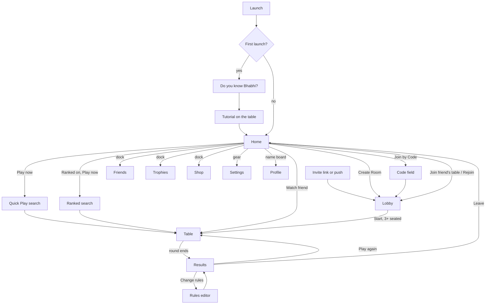

# Design direction: audience, principles and app flow

One place for what earlier design work decided: who Hulla is for, the rules every screen follows, the navigation, and where each tap leads. It pulls together the GDD (§1.3, §1.4, §5, §14), `ux-ui-pass.md`, `ui-redesign-brief.md`, `table-themes.md`, the two research notes and the owner's decisions of 15 October 2026. Where those disagree, the newest decision wins and is marked here.

Status: 26 October 2026.

## 1. Who we design for

| Segment | Share of attention | Who | What Home must do for them |
|---|---|---|---|
| Friend groups | Primary (the majority) | 16–35, Pakistan, India, Bangladesh, Gulf and Western diaspora; a WhatsApp group, a hostel, an office | Get the group into one room in under a minute: create, share, join, see who is online and at which table |
| Families and diaspora | Primary | 25–55, across time zones; relatives who are not gamers | Join from a link with no account, large readable text, forgiving timers, nothing that looks like gambling, a look elders are at ease with |
| Competitors | Secondary (v1.1) | 18–30, mostly male, Ludo King and Callbreak ranked players | Ranked one tap from Play, league and rating visible, bragging rights |
| Solo and commute | Tertiary | Anyone, short sessions, patchy networks | Play now with strangers, a table in 20 s, light progression |

Devices: mostly low and mid-range Android (720×1600 and 1080×2400, 2–4 GB), often used outdoors in daylight; then iPhones; tablets in both orientations. Personas: Ali (24, Lahore, hostel group), Sara (29, Karachi, commute), Imran (38, Manchester, Eid with cousins), Hamza (20, Islamabad, ranked), Priya (22, Delhi, random tables), GDD §5.1.

What this means for the look:
- **The majority** is young, social, loud and proud of the culture: festive colour, truck art, rooftops, banter, the thulla slap. Bold and local wins.
- **The wider market** (families, diaspora kids, Indian and Bangladeshi players who know the game as Bhabhi, and future games beyond cards) needs a look that is warm but not tied to one city, readable at a glance, calm enough for elders and modern enough for the diaspora's other apps.
- One structure carries both: themes (§4.3 of the brief) reskin the same layout, so the default theme can serve the majority while others serve the rest.

## 2. Design principles

**Product (from the GDD and the UX pass)**
1. **A baithak, not a casino.** No chips, buy-ins, spins, jackpots, money symbols or gambling words. The payoff is the thulla and the Bhabhi stamp.
2. **Friends first.** Every screen answers "who is here and how do I get them in". Create, share and join are never more than one tap from Home.
3. **Fast to a game.** Under 60 s from cold launch to the first card; one tap to Play now; a link joins without an account.
4. **Stay together.** Nothing between rounds sends the group back to a menu; rematch, rule changes and invites happen at the table.
5. **Never interrupt a trick.** No dialog, banner or ad over the hand or the pile; status uses pills.
6. **Fairness you can see.** The fair-deal tick, auto-played seats and (later) bots are always labelled.
7. **One thing at a time.** One currency on screen, one progression banner, one event surface; the pass and missions are badges until opened.
8. **Pills, not modals.** Dialogs only for one question with two answers.

**Look and feel (from the art direction and the visual scan)**

9. **A game, not an app.** Screens are scenes; controls are objects (wood, brass, enamel, lacquer) with a pressed state, not flat boxes.
10. **One hero per screen.** On Home it is Play now; on the table it is the thulla moment. Everything else is visibly smaller.
11. **Gentle life.** Ambient motion is slow and small (string bulbs, kites, steam); nothing pops unless it is an event; reduce motion freezes it.
12. **Small details matter.** Text centred in its plate, nothing stretched, nine-slice art with clean corners, checked at phone size on a real device.
13. **Culture without exclusion.** Truck art, rooftops, chai and festivals; no religious buildings in the scene (decided 15 Oct: no minaret variant) and no single country's currency sign.

**Build constraints**

14. **Low-end Android first.** No blur, no full-screen video, few transparent layers, 240 ms screen transitions.
15. **Text is live where it changes.** Static labels may be baked into art per language; names, numbers and anything translated at runtime are drawn by the app. Allow 40% growth and right-to-left for Urdu.
16. **One design, three size classes.** Compact, Medium and Expanded rearrange the same screens (brief §2.3); 48 dp targets; text to 200%.

## 3. Navigation (decided 15 October 2026)

- **Bottom dock, four tabs:** Home · Friends · Trophies · Shop.
  - Trophies holds Missions, Achievements and the Leaderboard (Ranked opens from the Leaderboard and from the Ranked switch on Home).
  - Shop has two sub-tabs, Shop and Pass; owned items are equipped from its grid.
- **Settings** opens from a small gear at the top left of every tab screen, full screen, with Done and no dock.
- **Profile** opens by tapping your own name board or avatar on Home (and your row anywhere).
- The dock is hidden in Quick Play search, the lobby, the table, results, the tutorial and Settings. Results gets a Leave plank instead.
- Badges: Friends (requests, friends at a joinable table), Trophies (missions to claim), Shop (pass tiers to claim, the weekly spotlight once a week).

This replaces the five tabs in the brief (§6) and the Home · Friends · Inventory · Settings dock in the concept pack's own documents (`art-design/01-ux-audit.md`, `04-screen-wireframes-and-flows.md`), which predate the decision.

## 4. App flow

## 5. Every tap and where it leads

### 5.1 Home
Home order, top to bottom: header, friends, the "your move" banner, the game shelf with the hero, room actions, daily reward, other games. The header and dock stay fixed; the middle scrolls on short phones.

| Element | Tap does | Goes to | What is there |
|---|---|---|---|
| Gear (top left) | Opens Settings | Settings (full screen) | Playing, sound, table theme, seeing and moving, notifications, privacy, account and data, language, help |
| Name board / avatar | Opens your profile | Profile | Avatar, frame, title, name, handle, bio, friend code, stats, Achievements link |
| Level shield | Same as the name board | Profile | |
| Coin balance | Opens the shop | Shop tab | Grid, balances; never a top-up offer while monetisation is on hold |
| Friend avatar (online row) | Opens the player sheet | Sheet over Home | Join or Watch their table, Invite to mine, Favourite, Remove, Block, Report |
| + Invite | Shares your friend code or a room link | Phone share sheet | WhatsApp first |
| "Ali's table · 2 seats open" banner | Joins the table | Lobby (or Table if the round runs and you can watch) | Refusal in plain words if full or private |
| "Rejoin your table (7KQ2M)" banner | Rejoins (30 min after leaving mid-round) | Table | Your seat, auto-play stopped |
| Seat coins 3 · 4 · 5 · 6 | Picks the table size for Play now | Stays on Home | Locked to 4 and dimmed while Ranked is on |
| Casual / Ranked switch | Picks the queue | Stays on Home | Ranked shows the league badge on the hero; first use explains the fixed ranked rules once |
| PLAY NOW | Starts matchmaking | Quick Play search | "Finding a table for 4…", seconds, Cancel → Home; table found → Table |
| Create Room | Creates a private table | Lobby as host | Room code, Copy, Share Invite, Invite friends, seat ring, Edit rules, Start |
| Join by Code | Opens the code field | Field on Home, then Lobby | Code, Join; refusal in plain words |
| Daily Reward | Claims today's reward | Stays on Home | Chest opens, coins fly to the balance, count ticks up; then "Tomorrow: 80 coins" |
| How to play (book icon or in Settings) | Starts the tutorial | Table, tutorial mode | Five steps, coach bubble |
| Other games (Rung, then Ludo, Tambola…) | Shows "Coming soon" | Stays on Home | Optional "Tell me when it's out" toggle |
| Dock: Friends | | Friends | Add by code, requests, friends, waiting, played with recently, blocked |
| Dock: Trophies | | Trophies | Missions (today, this week), Achievements, Leaderboard → Ranked |
| Dock: Shop | | Shop | Sub-tabs Shop and Pass |

### 5.2 The play path
| From | Element | Goes to | Notes |
|---|---|---|---|
| Quick Play search | Cancel | Home | |
| Lobby | Copy / Share Invite / Invite friends | Clipboard / share sheet / invite sheet | Invite sheet lists friends online first |
| Lobby | Empty seat | Invite sheet | |
| Lobby | Edit rules (host) | Rules editor | Others see "{name} changed the rules" |
| Lobby | Ready (guest) / Start (host, 3+) | Table | Public tables count down instead |
| Lobby | Leave | Home | |
| Table | Leave | Confirm, then Home | Seat goes to auto-play; Rejoin banner on Home for 30 min |
| Table | Rules | Rulebook | Opens at the section a hint pill points to |
| Table | Settings | Settings | Round keeps running underneath |
| Table | A seat | Player sheet | Mute, Block, Report, picked-up cards |
| Table | Quick chat / Chat | Bubble on your seat / chat sheet | |
| Table | Ask for hand | Request to the next player | Answer sheet on their side |
| Results | Play again | Table, next round | Avatars fill as players vote, 18 s |
| Results | Change rules (host) | Rules editor | Back to Results |
| Results | Share | Post or Story card | |
| Results | Add friend chip | Sends a request | Chip turns to "Sent" |
| Results | Fair deal | Explainer | Close, Copy the seed |
| Results | Leave | Home | |

### 5.3 Tab screens
| Screen | Element | Goes to |
|---|---|---|
| Friends | Friend row | Player sheet (Join, Watch, Invite, Favourite, Remove, Block, Report) |
| Friends | Add by code, Accept, Decline, Cancel, Unblock | Stays, row updates |
| Trophies | Missions: Claim, Swap | Stays, coins fly to the balance |
| Trophies | Achievements tile | Detail sheet |
| Trophies | Leaderboard: week/month, everyone/friends, Ranked | Board; Ranked card with Play ranked → Ranked search |
| Shop | Item | Detail sheet: Buy & Equip (coins) or Equip |
| Shop | Pass sub-tab, Claim | Tier claims; reached premium rewards glow as a teaser |
| Settings | Table theme tile | Whole app reskins at once |
| Settings | Link Phone Number | Phone overlay |
| Settings | Export Data / Delete Account | Dialog, then the flow |

## 6. What we still need

**Decisions (owner)**
- Pick a Home direction from the concepts (`art-design/concepts/`), or keep Rooftop and treat the others as themes.
- Whether Play now (strangers) or Create Room (friends) is the hero for a first-time player with no friends yet; whether that changes once friends exist.
- Seat coins 3–6 or 4–6 on Home (the app has 3; the reference shows 4–6).
- Daily reward object: keep the chest (show the amount so it never reads as a loot box) or a potli or gift.

**Art (per `art-design/audit/`)**
- About 690 files at 2x for the Rooftop build, Home first (about 43), plus `_en` twins per language later.
- Home pieces not in the reference: the friends row, the "your move" banner plate, the coin plate, the Rung tile, the Trophies and Shop tab icons.
- Home and Table in the other four themes.

**Engineering**
- The navigation change in §3 (Trophies and Shop tabs, the gear, Settings without the dock, the Leave plank on Results).
- The friends row and the banner on Home; Ranked locking the seat coins to 4.
- Size classes and safe areas (brief §2).
